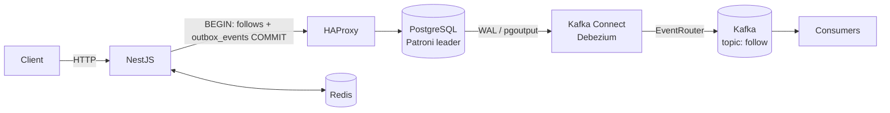

<div align="center">

# Fakegram Backend

Учебный проект, повторяющий функциональность Instagram. Серверная часть на NestJS в стиле Clean Architecture.


</div>

## Содержание

- [Возможности](#возможности)
- [Стек](#стек)
- [Архитектура](#архитектура)
- [Структура проекта](#структура-проекта)
- [Быстрый старт](#быстрый-старт)
- [Переменные окружения](#переменные-окружения)
- [Скрипты](#скрипты)
- [API](#api)
- [Связанные репозитории](#связанные-репозитории)
- [Лицензия](#лицензия)

## Возможности

- Регистрация и вход по логину и паролю
- JWT: access-токен и refresh-токен в httpOnly-cookie с ротацией
- Проверка существования пользователя
- Подписки и отписки с публикацией событий через Transactional Outbox
- Rate limiting (три окна: секунда, 10 секунд, минута)
- Swagger-документация

## Стек

| Область | Технологии |
|---------|------------|
| Приложение | NestJS 11, TypeScript, class-validator, Swagger |
| База данных | PostgreSQL 17 в HA-кластере Patroni (etcd + HAProxy), Prisma 7 с `@prisma/adapter-pg` |
| События | Apache Kafka (KRaft), Kafka Connect + Debezium, kafkajs |
| Кэш | Redis 7.4 (ioredis) |
| Инфраструктура | Docker, Docker Compose (dev / prod) |

## Архитектура

Код разделён на слои Clean Architecture, зависимости направлены внутрь:

| Слой | Каталог | Ответственность |
|------|---------|-----------------|
| Domain | `src/domain` | сущности, value objects, интерфейсы репозиториев |
| Application | `src/application` | use cases |
| Infrastructure | `src/infrastructure` | Prisma, Redis, Kafka, мапперы, реализации репозиториев |
| Presentation | `src/presentation` | контроллеры, DTO, guards, фильтры, Swagger |

### Transactional Outbox

События не отправляются в Kafka из кода приложения. Репозиторий в одной транзакции изменяет бизнес-таблицу
и записывает событие в `outbox_events`. Debezium читает WAL PostgreSQL, а SMT `EventRouter` публикует событие
в топик, указанный в `aggregatetype`. Строка outbox удаляется в той же транзакции, поэтому таблица не растёт.



Формат события в топике `follow`:

| Часть сообщения | Значение |
|-----------------|----------|
| ключ | `followerId_followingId` |
| заголовок `eventType` | `follow` / `unfollow` |
| заголовок `id` | UUID события, для дедупликации на стороне потребителя |
| значение | `{ "id", "followerId", "followingId", "createdAt" }` |

## Структура проекта

```text
.
├── docker/                  # скрипты init-контейнеров и конфигурация коннекторов Debezium
│   ├── app/                 # prisma migrate deploy с ретраями
│   ├── debezium/            # регистрация коннекторов, connectors/*.json
│   └── kafka/               # создание топиков
├── docs/
│   └── DOCKER.md            # подробное описание docker-окружений
├── prisma/
│   ├── migrations/
│   └── schema.prisma
├── src/
│   ├── application/
│   ├── domain/
│   ├── infrastructure/
│   ├── presentation/
│   ├── app.module.ts
│   └── main.ts
├── docker-compose.yml       # общая часть
├── docker-compose.dev.yml   # dev: hot reload, debug, Kafka UI, порты наружу
├── docker-compose.prod.yml  # prod: 3 брокера Kafka, секреты обязательны
└── Dockerfile               # multi-stage: development / migrator / production
```

## Быстрый старт

### Требования

- Docker с Compose v2
- Node.js 24 и npm 11 (для локального запуска без контейнера)
- Запущенный кластер PostgreSQL из [patroni-fakegram](https://github.com/CodedSplash/patroni-fakegram)

### 1. PostgreSQL

```bash
git clone https://github.com/CodedSplash/patroni-fakegram.git
cd patroni-fakegram/fakegram
docker compose --env-file .env.dev -f docker-compose.yml -f docker-compose.dev.yml up -d --build
```

Кластер создаёт docker-сеть `fakegram-db-network`, базу `fakegram`, роли приложения и Debezium.

### 2. Backend в Docker

```bash
git clone https://github.com/CodedSplash/Fakegram-backend.git
cd Fakegram-backend
npm run docker:dev
```

| Сервис | Адрес |
|--------|-------|
| API | http://localhost:8080 |
| Swagger | http://localhost:8080/swagger |
| Node.js debugger | localhost:9229 |
| Kafka UI | http://localhost:8085 |
| Kafka Connect REST | http://localhost:8083 |

### 3. Backend локально, инфраструктура в Docker

```bash
npm ci
cp .env.example .env
npm run docker:dev:infra
npm run prisma:generate
npm run prisma:migrate:deploy
npm run start:dev
```

### Production

```bash
cp .env.docker.prod.example .env.docker.prod
npm run docker:prod
```

Compose не запустится, пока в `.env.docker.prod` не заданы пароли, `KAFKA_CLUSTER_ID` и JWT-секреты.
Подробности — в [docs/DOCKER.md](docs/DOCKER.md).

## Переменные окружения

| Переменная | По умолчанию | Описание |
|------------|--------------|----------|
| `PORT` | `8080` | порт HTTP-сервера |
| `MODE_ENV` | — | `dev` включает подробные ошибки в ответах |
| `DATABASE_URL` | — | строка подключения PostgreSQL (через HAProxy, порт `5000`) |
| `DATABASE_POOL_MAX` | `10` | размер пула соединений |
| `REDIS_URL` | — | строка подключения Redis, имеет приоритет над `REDIS_*` |
| `REDIS_HOST` / `REDIS_PORT` | `localhost` / `6379` | адрес Redis |
| `REDIS_PASSWORD` / `REDIS_USERNAME` / `REDIS_DB` | — / — / `0` | авторизация и номер БД Redis |
| `KAFKA_BROKERS` | `localhost:9094` | брокеры Kafka через запятую |
| `KAFKA_CLIENT_ID` | `fakegram-backend` | client id Kafka |
| `SECRET_PASSWORD_KEY` | — | ключ HMAC-SHA256 для хеширования паролей |
| `SECRET_ACCESS_JWT_KEY` | — | секрет access-токена |
| `SECRET_REFRESH_JWT_KEY` | — | секрет refresh-токена |

Шаблоны: `.env.example` (локальный запуск), `.env.docker.dev`, `.env.docker.prod.example`.

## Скрипты

| Команда | Описание |
|---------|----------|
| `npm run start:dev` | запуск с hot reload |
| `npm run start:debug` | запуск с отладчиком |
| `npm run build` / `npm run start:prod` | сборка и запуск production-сборки |
| `npm run lint` / `npm run format` | ESLint и Prettier |
| `npm test` | запуск тестов (Jest) |
| `npm run prisma:generate` | генерация Prisma Client |
| `npm run prisma:migrate:deploy` | применение миграций |
| `npm run docker:dev` / `docker:dev:down` / `docker:dev:logs` | dev-окружение в Docker |
| `npm run docker:dev:infra` | только Redis, Kafka, Kafka Connect, Kafka UI |
| `npm run docker:prod` / `docker:prod:down` / `docker:prod:logs` | prod-окружение в Docker |

## API

Полная спецификация доступна в Swagger: `/swagger`.

| Метод | Путь | Авторизация | Описание |
|-------|------|:-----------:|----------|
| `POST` | `/auth/registration` | — | регистрация |
| `POST` | `/auth/login` | — | вход |
| `PUT` | `/jwt/refresh_token` | cookie `refreshToken` | обновление пары токенов |
| `GET` | `/user/has_user/:username` | — | проверка существования пользователя |
| `POST` | `/user/follow` | Bearer | подписка |
| `POST` | `/user/unfollow` | Bearer | отписка |

## Связанные репозитории

| Репозиторий | Назначение |
|-------------|------------|
| [Fakegram-frontend](https://github.com/CodedSplash/Fakegram-frontend) | клиент на Next.js |
| [patroni-fakegram](https://github.com/CodedSplash/patroni-fakegram) | HA-кластер PostgreSQL (Patroni, etcd, HAProxy) |

## Лицензия

[MIT](LICENSE) © 2024-2026 Ivan Shchukin
